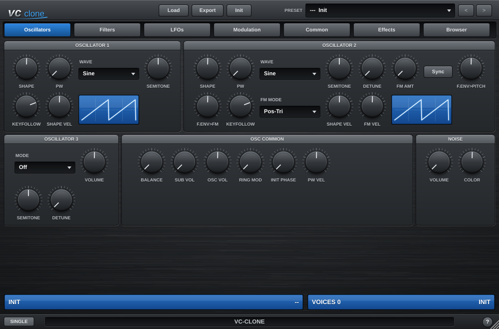

# VC-Clone

A clean-room software synth (VST3 instrument, Windows x64) for A/B testing against the Osirus
emulator running a Virus C OS 6.6 ROM. It imports Access Virus A/B/C single presets from
`.mid` / `.syx` files byte-exactly. It does **not** need, read, embed or translate any Access ROM or
DSP code: the sound engine is written from the documented parameter set, and is then calibrated by
measuring Osirus's audio, with Osirus used only as a black box.

The GUI follows the Virus Delay plugin: procedurally drawn panels, knobs, mode tabs and blue LCDs, with no image assets.



## Status

| Part | State |
|---|---|
| PresetIO (SMF type 0/1, `.syx`, checksum, TI-dump fallback, OS-file rejection, byte-exact export) | done, 13 Catch2 test cases incl. fuzzing |
| Engine (osc 1-3, sub, noise, ring, FM, sync, SVF + ZDF ladder, routings, 15 saturation curves, envelopes with sustain slope, 3 LFOs, 9-slot mod matrix, unison, key modes, portamento, arpeggiator, distortion, analog boost, EQ, chorus, phaser, delay/reverb) | done, behaviour **not yet calibrated** |
| VST3 plugin (resizable GUI, preset browser, warnings, CC map, SysEx in) | done |
| `vc_render` CLI | done |
| Calib harness (probes, sweeps, null/STFT/LUFS/centroid/envelope metrics, fitting, HTML report, blind A/B) | done. Self-check passes; **not yet run against Osirus** (needs your Windows machine + ROM) |

**Every 0-127 → physical mapping is still a documented guess** (`Engine/Tables/Tables.h`; the Browser tab and
`vc_render --tables` list them). They become "measured" once you run the calibration below.

## Download

CI builds every push to `main` on `windows-latest` and puts the zips on the `builds` branch:

```bash
git fetch origin builds && git checkout origin/builds -- VC-Clone-VST3-Windows-x64.zip vc_render-Windows-x64.zip
```

Unzip `VC-Clone.vst3` into `C:\Program Files\Common Files\VST3`.

## Using the plugin

* **Load** (or drag a file onto the window) opens a Virus bank (`.mid` / `.syx`). Access OS-update `.mid` files are refused.
* **Preset** / **< >** choose a patch, **Init** loads a plain saw patch, **Export** writes the patch or bank as `.syx` / `.mid`.
* **Tabs**: Oscillators, Filters (incl. both envelopes), LFOs, Modulation (Assign 1-6), Common (patch, amp, key mode, unison, arp), Effects, Browser.
* **Knobs** show the raw Virus values (0-127, or the parameter's own range), so they match the Virus/Osirus displays one-to-one.
  Every knob moves in whole steps of **1.0**: drag (Shift = slower drag, still whole steps), **mouse wheel = ±1 per notch**,
  double-click = default. Dropdowns also step one entry per wheel notch.
* **Resizable**: drag the bottom-right corner (70-250 %, fixed aspect ratio). The size is remembered.
* The **Browser** tab lists the bank, the import warnings (checksum, clamped out-of-range bytes), the parameters that
  this patch uses but v1 ignores (input, vocoder, input follower, second output), and which tables are guessed or measured.
* MIDI: notes, pitch bend, channel pressure, the Virus CC map (`controllerMap`), Virus SysEx single dumps and parameter changes.

## Building (Windows)

Requirements: Visual Studio 2022, CMake 3.22+ and Python 3 (the parameter layout is generated from `reference/` at build time).
JUCE 8.0.4 and Catch2 are downloaded automatically.

```bash
cmake -B build -A x64
```

```bash
cmake --build build --config Release --target VCClone_VST3 vc_render vc_tests
```

```bash
build/Release/vc_tests.exe
```

Output: `build/VCClone_artefacts/Release/VST3/VC-Clone.vst3`, `build/Release/vc_render.exe`.

Options: `-DVCCLONE_BUILD_STANDALONE=ON` (standalone app), `-DVCCLONE_COPY_AFTER_BUILD=ON` (install into the VST3 folder),
`-DJUCE_DIR=...` (local JUCE), `-DVCCLONE_BUILD_SNAPSHOT=ON` (`vc_ui_snapshot`, renders every tab to PNG).

## vc_render

```bash
vc_render --preset bank.mid --index 5 --notes "60:0.0:2.0:100" --len 4 --sr 44100 --out x.wav --set "Cutoff=80"
```

Deterministic (fixed RNG seed, `--seed N`). Also: `--list` (patches in a file), `--json patch.json` (dump the parsed
patch), `--syx out.syx`, `--cc t:cc:val`, `--bend t:value14`, `--bpm`, `--block`, `--tables`.

## 1:1 testing against Osirus (Calib/)

```bash
cd Calib
```

```bash
python -m pip install -r requirements.txt
```

Copy `config.example.json` to `config.json` and set the Osirus `.vst3` path, `vc_render.exe` and your bank files.
Load your Virus C ROM in Osirus once, in Osirus's own UI. The tooling never opens the ROM.

```bash
python -m vcclone_calib rate
```

```bash
python -m vcclone_calib noise-floor
```

```bash
python -m vcclone_calib suite --patches
```

```bash
python -m vcclone_calib fit results/<run>/results.json
```

* `rate` measures Osirus's internal sample rate (noise rendered at 96/192 kHz) and records it.
* `noise-floor` renders every patch job through Osirus twice. The STFT distance between the two renders sets the PASS threshold.
* `suite` renders every probe, sweep and patch through both synths (Osirus renders are cached by a hash of preset + MIDI + settings + plugin binary).
  It aligns latency by cross-correlation, then measures and prints `block | tests | pass | fail | worst error`.
  It also writes `results/<run>/report.html` (ranked worst-first, sweep plots, audio players for Osirus / VC-Clone / difference),
  `ab.html` (blind A/B listening test) and the WAVs. The run exits non-zero on any regression against the last passing baseline.
* `fit` writes `Engine/Tables/Measured.h` from the Osirus side of a sweep run (`--full` gives every value 0..127).
  Rebuild, then run `suite` again.
* `pytest tests/test_one_to_one.py` runs the same probes as a pytest suite. `tests/test_selfcheck.py` checks the harness itself without Osirus.

Tolerances (`Calib/vcclone_calib/probes.py`): pitch ±1 cent, cutoff ±3 %, envelope times ±5 %, levels ±0.5 dB,
null residual ≤ -30 dB on deterministic probes, and STFT ≤ the Osirus-vs-Osirus floor.
Free-running material (noise, S&H, chorus/phaser LFOs, unison, rate reducer) is compared statistically
(long-term spectrum, rates), not sample by sample. Results are reported as "matches within X", never as bit-identical.

**Preset delivery:** VST3 hosts (pedalboard included) generally do not deliver SysEx to VST3 plugins, so the harness sets
each patch byte through the plugin's host parameters, matched by name (`"preset_method": "params"`). Bytes that Osirus does not
expose as parameters keep Osirus's current values. `"sysex"` is available for hosts that pass SysEx through.

## Open questions for calibration

* **Sustain Time**: the engine assumes 64 = hold, <64 falls and >64 rises, because 64 is the most common factory value (61-72 % of patches).
  Osirus's value list labels 0 "Infinite" and 64 "Fall". The `env/amp_sustain_time` probes settle this.
* **Noise level vs Osc Volume**: the engine assumes Noise and Ring Mod volumes are independent of Osc Volume.
* **Spectral waves 3-64**: placeholder harmonic sets until `suite --full` + `fit` measure them.
* Effect order, filter balance law, mod-matrix scaling, velocity laws and arp patterns 2-64 are all hypotheses (see `Engine/`).

## Project layout

```
reference/                  Virus C byte map, Osirus parameter JSON/value lists, factory usage stats, spec
tools/gen_layout.py         CSV + JSON -> VirusCLayout.h (build time)
PresetIO/                   pure C++ import/export (no JUCE)
Engine/                     DSP (no JUCE); Tables/ holds every value mapping (guessed or measured)
Plugin/                     JUCE wrapper and GUI (Virus Delay look and feel)
cli/vc_render.cpp           headless renderer
tests/                      Catch2 tests
Calib/                      Python measurement, fitting and 1:1 regression tooling
```

## Licence note

`reference/` contains data derived from the GPL-3 Gearmulator project. This is a private test build.
Do not redistribute it unless the project is GPL-3. "Virus" is used only descriptively. No Access logos, artwork, ROM or DSP code are included.
